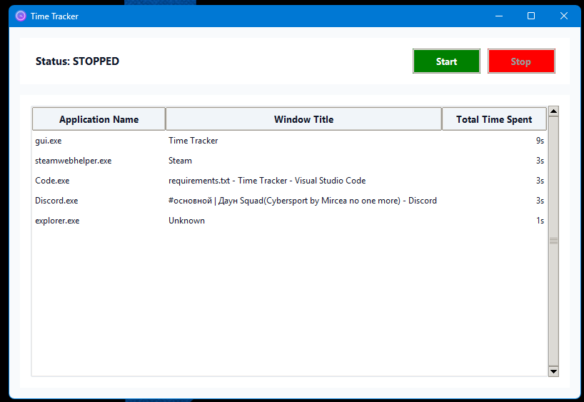

# ⏱️ Windows Time Tracker

A lightweight, local-first Windows desktop application built with Python and Tkinter that automatically tracks active application usage and window focus.



## ✨ Key Features
* **Automatic Focus Tracking:** Detects active window switches in real time using native Windows API hooks (`ctypes`).
* **Local Data Privacy:** Stores all session data locally in a lightweight SQLite database.
* **Aggregated Usage Summary:** Displays total active time per application, formatted cleanly (hours, minutes, seconds).
* **Modern GUI:** Styled Tkinter (`clam` theme) with custom window icons and taskbar integration.
* **Zero Overhead:** Event-driven architecture with ~0% CPU background usage.

## 🚀 Quick Start (For Developers)

### Prerequisites
* Python 3.10+
* Windows 10/11

### Installation
```powershell
# Clone repository
git clone [https://github.com/MissingMirkea/TIme-Tracker.git](https://github.com/MissingMirkea/TIme-Tracker.git)
cd TIme-Tracker

# Create and activate virtual environment
python -m venv venv
.\venv\Scripts\activate

# Install dependencies
pip install -r requirements.txt

# Run Application
python gui.py
